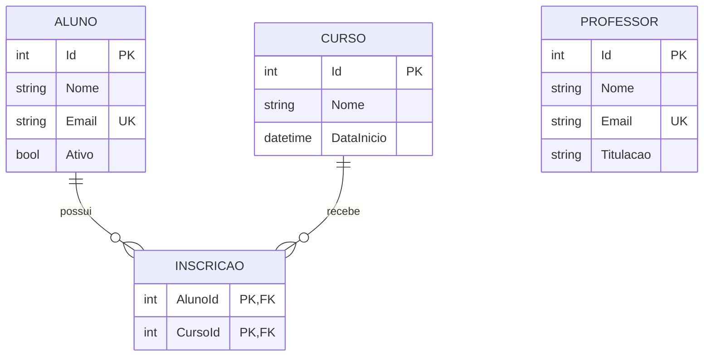
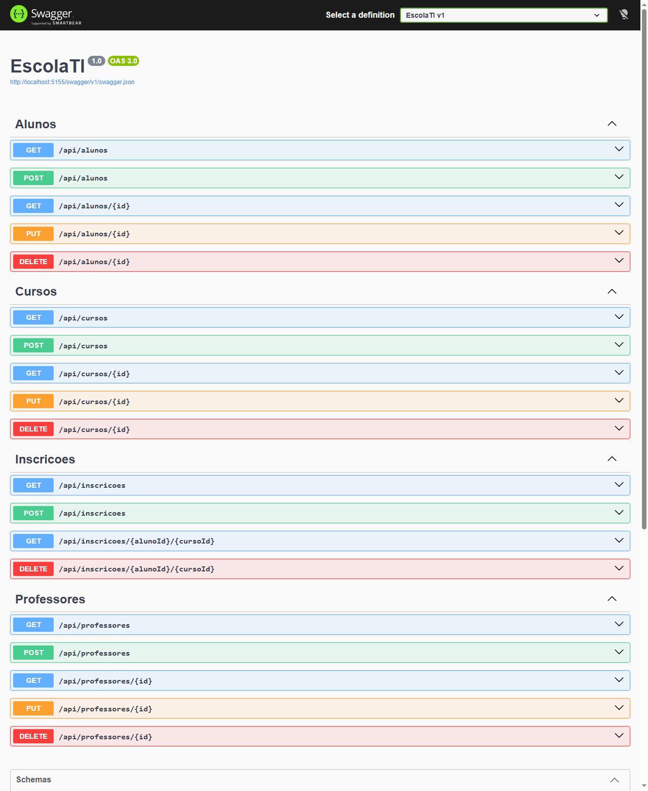

# Escola TI

## Visão geral — qual problema resolve?
Uma escola de tecnologia precisa saber quem são seus alunos e professores, quais cursos oferece e quem está inscrito em cada um. O Escola TI é uma API REST que centraliza esses cadastros em um banco de dados e aplica as regras que evitam dados inconsistentes, como e-mails repetidos ou inscrições duplicadas.

**Estágio atual:** API funcional para uso local, sem autenticação e sem interface própria (a interação é feita pelo Swagger ou por um cliente HTTP).

## Funcionalidades implementadas
| Recurso | Rotas | Operações |
| --- | --- | --- |
| Alunos | `/api/alunos`, `/api/alunos/{id}` | listar, consultar, criar, atualizar, excluir |
| Professores | `/api/professores`, `/api/professores/{id}` | listar, consultar, criar, atualizar, excluir |
| Cursos | `/api/cursos`, `/api/cursos/{id}` | listar, consultar, criar, atualizar, excluir |
| Inscrições | `/api/inscricoes`, `/api/inscricoes/{alunoId}/{cursoId}` | listar, consultar, criar, excluir |

A inscrição não tem atualização porque é identificada apenas pelo par aluno/curso: para trocar de curso, exclua a inscrição e crie outra.

**Regras e validações**

| Situação | Resposta |
| --- | --- |
| Campo obrigatório ausente, e-mail ou data inválidos, texto acima do limite, JSON malformado | `400` |
| Inscrição de aluno inativo, de aluno inexistente ou em curso inexistente | `400` |
| Recurso não encontrado | `404` |
| E-mail já cadastrado para outro aluno ou professor (sem diferenciar maiúsculas) | `409` |
| Aluno já inscrito no mesmo curso | `409` |
| Exclusão de aluno ou curso que possui inscrições | `409` |

## Tecnologias
- C# e .NET 10 (ASP.NET Core Web API)
- Entity Framework Core 10 com SQLite
- Swagger (Swashbuckle)
- xUnit e `WebApplicationFactory` nos testes

## Arquitetura
Aplicação em camada única, adequada ao tamanho atual: os controllers recebem as requisições, aplicam as regras e acessam o banco pelo `EscolaContext`. As entradas usam DTOs próprios, de modo que o cliente não consegue definir campos como o `Id`.

```text
src/EscolaTI/
├── Controllers/   Endpoints e regras de negócio
├── Data/          EscolaContext, migrações e tratamento de conflitos do banco
├── Dtos/          Dados de entrada e suas validações
└── Models/        Aluno, Professor, Curso e Inscricao
tests/EscolaTI.Tests/   Testes de integração da API
```



O SQLite foi escolhido para que o projeto rode sem instalar um servidor de banco de dados. O acesso passa pelo EF Core, o que facilita uma futura troca de banco.

## Como executar
**Pré-requisito:** [SDK do .NET 10](https://dotnet.microsoft.com/download/dotnet/10.0).

```bash
git clone https://github.com/marcelobastoni/EscolaTI.git
cd EscolaTI
dotnet run --project src/EscolaTI --launch-profile http
```

Abra http://localhost:5155/swagger. O banco `escolati.db` é criado automaticamente em `src/EscolaTI/` na primeira execução.

Exemplo de criação de um aluno:

```bash
curl -X POST http://localhost:5155/api/alunos \
  -H "Content-Type: application/json" \
  -d '{"nome":"Ana Souza","email":"ana@escola.com"}'
```

```json
{"id":1,"nome":"Ana Souza","email":"ana@escola.com","ativo":true}
```

## Testes e validação
```bash
dotnet test
```

- **Testes automatizados:** 29 casos aprovados, cobrindo o CRUD de cada recurso, as validações, os conflitos e as regras de inscrição. Eles sobem a API real em um banco SQLite temporário, com as migrações aplicadas.
- **Teste manual de ponta a ponta:** a partir de um clone limpo, com a API em execução, 29 chamadas HTTP retornaram o status esperado, incluindo a verificação de que os dados persistem após reiniciar a aplicação.

## Capturas de tela
Endpoints documentados no Swagger:



## Minha contribuição
- Modelagem inicial do domínio: alunos, professores, cursos e inscrições.
- Definição do escopo da modernização, do plano de execução e do padrão de documentação.
- A atualização para .NET 10, o banco de dados, o CRUD e os testes foram implementados com apoio de IA (Claude Code), sob minha direção.

## Limitações e próximos passos
**Limitações**
- Não há autenticação nem autorização: não exponha a API publicamente neste estágio.
- O professor ainda não está vinculado aos cursos.
- As listagens não têm paginação nem filtros.
- A validação de e-mail verifica apenas o formato básico (aceita `a@b`, por exemplo).
- O SQLite atende ao uso local, mas não é indicado para muitas escritas simultâneas.
- O ambiente de produção não foi configurado: o projeto não tem publicação nem integração contínua.

**Próximos passos**
1. Vincular professores aos cursos.
2. Adicionar autenticação e perfis de acesso.
3. Adicionar paginação e filtros às listagens.
4. Configurar integração contínua com execução dos testes.
5. Avaliar um banco de dados servidor e a publicação em nuvem.

---
O estado do projeto antes desta modernização está preservado na tag [`v0-original`](https://github.com/marcelobastoni/EscolaTI/tree/v0-original).
